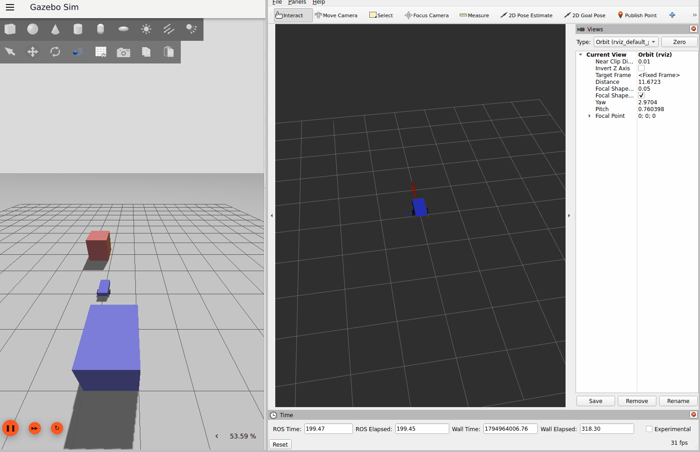

# ROS 2 Differential Drive Robot Simulation using Gazebo




## Purpose & Learning Goals

I created this repository as a hands-on learning project to understand how mobile robots are modeled, simulated, and controlled in **ROS 2 Jazzy** and **Gazebo Harmonic**.

My main targets for this baseline project were:

* Learn how to build a custom robot model from scratch using **URDF / Xacro** with proper inertia, collision geometry, and ground clearance.

* Understand how Gazebo Harmonic's `DiffDrive` plugin works and how it differs from legacy Gazebo Classic plugins.

* Connect Gazebo simulation topics (`/cmd_vel`, `/odom`, `/clock`, `/tf`, `/joint_states`) to ROS 2 using `ros_gz_bridge`.

* Build a complete TF tree on the ROS 2 side and visualize the robot, its frames, and its odometry in **RViz2**.

* Automate launching the world, spawning the robot, starting the topic bridges, and opening RViz2 using a single Python launch file.

## Requirements & Prerequisites

Before running this project, make sure your environment has the following installed:

* **Operating System:** Ubuntu 24.04 LTS (Noble Numbat) — native Linux or via WSL2 on Windows

* **ROS 2 Distribution:** ROS 2 Jazzy Jalisco (compatible with Ubuntu 24.04 LTS)

* **Simulator:** Gazebo Harmonic (compatible with ROS 2 Jazzy)

* **Required ROS 2 Packages:**

  * `ros-jazzy-ros-gz` (for `ros_gz_sim` and `ros_gz_bridge`)

  * `ros-jazzy-xacro`

  * `ros-jazzy-robot-state-publisher`

  * `ros-jazzy-rviz2`

  * `ros-jazzy-teleop-twist-keyboard`

## Project Overview

This package (`my_diff_bot`) simulates a 3-wheeled differential-drive robot inside a custom SDF obstacle world:

* **Drive System:** Two actuated drive wheels (`8 cm` radius) controlled via `/cmd_vel` and a frictionless front caster wheel (`4 cm` radius) for balance.

* **Chassis (Robot main body) Geometry:** `0.5m x 0.3m x 0.15m` body with `8 cm` of ground clearance so the chassis never drags on the floor.

### Project Structure

```
my_diff_bot/
├── docs/
│   └── demo.gif                 # Demo of the robot in Gazebo and RViz2
├── launch/
│   └── sim_robot.launch.py      # Launches Gazebo, robot_state_publisher, spawner, bridge, and RViz2
├── rviz/
│   └── sim.rviz                 # Saved RViz2 layout (fixed frame, RobotModel, TF, Odometry)
├── urdf/
│   └── robot.urdf.xacro         # Robot links, joints, collision/inertia, DiffDrive and JointStatePublisher plugins
├── worlds/
│   └── simple_obstacle.sdf      # Custom ground plane and box obstacles
├── CMakeLists.txt
└── package.xml
```

## How It Works
- **`urdf/robot.urdf.xacro`**: Defines the chassis, caster wheel, and two actuated drive wheels. Gazebo's `DiffDrive` plugin computes wheel kinematics and odometry and publishes the `odom → base_link` transform on `/tf`. The `JointStatePublisher` plugin publishes the wheel joint angles on `/joint_states`.

- **`worlds/simple_obstacle.sdf`**: Sets up the ground plane, lighting, physics engine, and static box obstacles.

- **`launch/sim_robot.launch.py`**: Orchestrates the full stack. It starts Gazebo Harmonic, publishes the robot's TF tree via `robot_state_publisher`, spawns the URDF model, bridges the topics with `ros_gz_bridge`, and opens RViz2 with the saved config. Each bridge has a fixed direction: `/cmd_vel` goes from ROS 2 to Gazebo, while `/odom`, `/clock`, `/tf`, and `/joint_states` go from Gazebo to ROS 2.

- **`rviz/sim.rviz`**: Stores the RViz2 layout, so RViz2 opens with `odom` as the fixed frame and the RobotModel, TF, and Odometry displays already set up.

The resulting TF tree on the ROS 2 side:

```
odom
└── base_link
    ├── left_wheel
    ├── right_wheel
    └── castor_wheel
```

`odom → base_link` comes from the DiffDrive plugin, the wheel transforms come from `robot_state_publisher` using `/joint_states`, and the caster is a fixed joint.


## How to Build & Run

Open your **Ubuntu (Linux) or WSL2 terminal** before running the commands below.

### 1. Clone and Build

```
mkdir -p ~/ros2_ws/src
cd ~/ros2_ws/src
git clone https://github.com/uzairrana786/ros2-gazebo-differential-drive.git my_diff_bot

cd ~/ros2_ws
source /opt/ros/jazzy/setup.bash
colcon build --packages-select my_diff_bot
source install/setup.bash
```

### 2. Launch the Simulation

```
ros2 launch my_diff_bot sim_robot.launch.py
```
Gazebo and RViz2 open together. RViz2 loads the saved layout and shows the robot model, its TF frames, and the odometry.

### 3. Drive the Robot

Open a second Linux/WSL2 terminal, source ROS 2, and run the keyboard teleop node:

```
source /opt/ros/jazzy/setup.bash
ros2 run teleop_twist_keyboard teleop_twist_keyboard
```

Use `i` (forward), `j` (left), `l` (right), `,` (reverse), and `k` (stop) to drive around the obstacles. The robot moves in Gazebo and RViz2 at the same time, and RViz2 draws the odometry path behind it.

## Results & What Was Achieved

* Built a stable differential-drive URDF/Xacro model that spawns cleanly without clipping or dragging on the ground plane.

* Bridged ROS 2 and Gazebo Harmonic topics successfully (`/cmd_vel` commands move the wheels in real time and `/odom` publishes robot pose).

* Built a complete TF tree on the ROS 2 side (`odom → base_link → wheels`) by bridging `/tf` and `/joint_states` from Gazebo.

* Visualized the robot model, TF frames, and odometry trail live in RViz2, launched automatically with a saved configuration.

* Verified smooth steering and obstacle navigation using keyboard teleoperation.

## Next Steps

Now that the locomotion, ROS-Gazebo bridge, TF tree, and RViz2 setup are working, I am building a separate follow-up repository on top of this base to add a **2D LiDAR sensor**, visualize laser scans in **RViz2**, and work toward **SLAM** and autonomous navigation.

---

## Feedback & Suggestions
Since this is an active learning project, any suggestions for improvements, best practices, or guidance on where to take this next are always welcome. Feel free to open an issue or reach out!